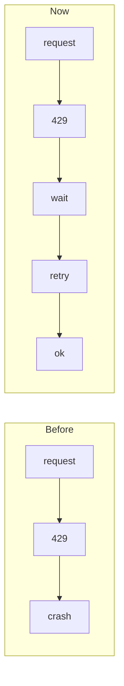
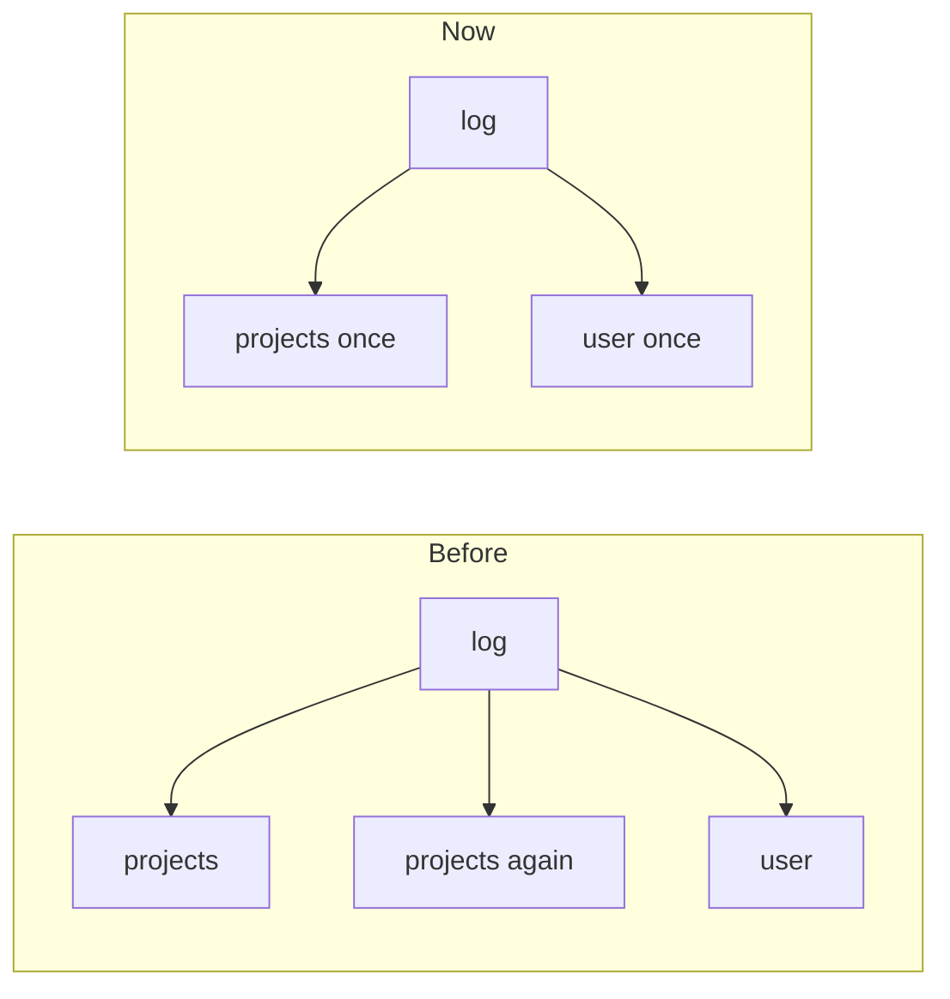

# Save point 1: Clockify no longer crashes on 429

**`clockify` now waits and retries when Clockify says "too many requests", makes fewer calls, and shows a one-line message instead of crashing.**

## Before and after

| Check | Where we started (main) | Last save point | Now |
|---|---|---|---|
| rate-limit-tests | — | — | passes |

## What changed

The result is F1, Shared client, per-run cache, retry on 429 (one idea).

- **F1**: Shared one connection across requests, fetched the user and project list once per run, retried 429/503 responses honouring Retry-After, and replaced tracebacks with a one-line error; 5 offline tests cover it.

## The ideas you need to know

### 1. Waiting your turn when the server says slow down *(HTTP 429 retry with backoff and Retry-After)*

When Clockify answers 'too many requests', the tool now pauses for as long as Clockify asks, then tries again, up to 4 times.

> A busy shop's sign says 'come back in 2 minutes'. You wait 2 minutes and try the door again, instead of leaving.

### 2. Asking once, remembering the answer *(per-run caching and a shared HTTP client)*

Who you are and your project list are fetched once per command and reused, so each run sends fewer requests.

> Writing down a phone number once instead of looking it up every time you call.

## What we learned

- Not tried yet against the live Clockify API; the 5 tests use a fake server.

## Try it

In `/Users/manuel/dev/cli-apps`: `git switch f1/shared-client-per-run-cache-retry-on-429`

## What's next

Run `clockify prospect` against your real account to confirm. Then you can publish F1 to `cli-apps`. Optionally, fix the `.flake8` setting so the line-length limit actually applies.

---

*1 ideas tried · 1 passed · 2m of work · about $0.96. Written with Darwin: numbers by Darwin, words by its coordinator.*
